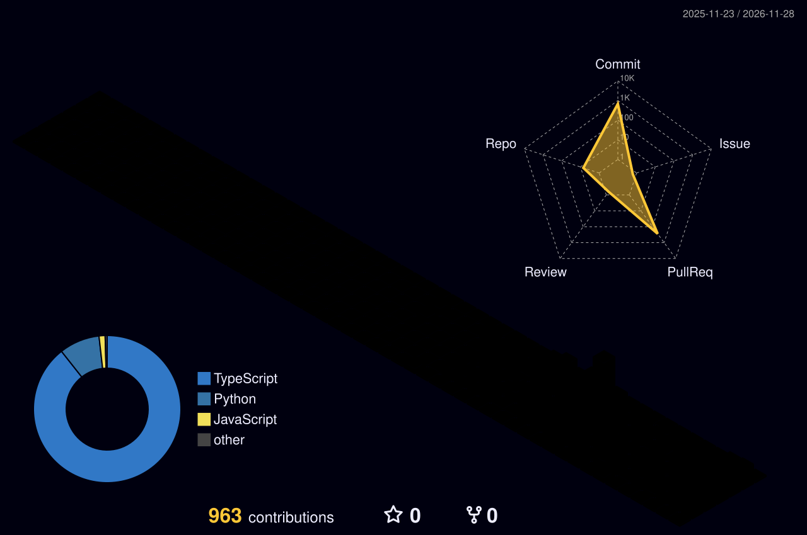

<!-- ===================== HEADER ===================== -->
<p align="center">
  
</p>

<p align="center">
  <a href="https://arslankareem.vercel.app">
    
  </a>
</p>

<p align="center">
  
  <a href="https://github.com/Arslank09?tab=followers"></a>
  <a href="https://arslankareem.vercel.app"></a>
  
</p>

## 🧑‍💻 About Me

```yaml
name: Arslan Kareem
role: Junior AI Engineer @ EHB Technologies
education: BS Computer Science @ Federal Urdu University, Islamabad
focus:
  - Tool-calling LLM agents (LangChain, LangGraph, FastAPI)
  - RAG, embeddings & hybrid search (pgvector, Postgres FTS)
  - Real-time backends (NestJS, WebSockets, Redis)
  - AI safety guardrails & evals
languages: [English, Urdu, Hindko]
reach_me: arslankarim9963@gmail.com
fun_fact: "My chatbot replies in Roman Urdu better than I text 😄"
```

- 🔭 Currently building **production AI assistants and search** at **EHB Technologies**
- 🧠 Shipped a **RAG pipeline on pgvector**, role-scoped agents and **guardrails** that stop ID leaks and made-up prices
- ⚡ Built a **real-time buyer–seller chat** end to end (Socket.IO, Redis presence, Web Push)
- 🌱 Currently learning **LLM evaluation, fine-tuning and MLOps**
- 💬 Ask me about **LLM agents, RAG, Redis, webhooks and the outbox pattern**
- 📫 Reach me at **[arslankarim9963@gmail.com](mailto:arslankarim9963@gmail.com)**

<h3 align="center">🤝 Connect With Me</h3>
<p align="center">
  <a href="https://www.linkedin.com/in/arslankareem"></a>
  <a href="mailto:arslankarim9963@gmail.com"></a>
  <a href="https://arslankareem.vercel.app"></a>
  <a href="https://github.com/Arslank09"></a>
</p>

<!-- ===================== DIVIDER ===================== -->


<h2 align="center">🛠️ Tech Stack</h2>

<details open>
<summary><b>🧠 AI / Machine Learning</b></summary>
<br/>
<p align="center">
  <br/><br/>
  
  
  
  
  
  
  
  
  
  
</p>
</details>

<details open>
<summary><b>⚙️ Backend & Languages</b></summary>
<br/>
<p align="center">
  
</p>
</details>

<details open>
<summary><b>🗄️ Databases, DevOps & Tools</b></summary>
<br/>
<p align="center">
  
</p>
</details>

<details open>
<summary><b>🎨 Frontend</b></summary>
<br/>
<p align="center">
  
</p>
</details>

<!-- ===================== DIVIDER ===================== -->


<h2 align="center">🚀 What I've Built at Work</h2>

| Area | Highlights |
|---|---|
| 🤖 **AI agents** | Role-scoped LLM assistants with tool calling. They support several model providers, keep conversation memory in Postgres, stream replies over SSE, and answer in English, Roman Urdu or Urdu. |
| 🔎 **RAG & search** | A pgvector knowledge base with evals. Hybrid product search combines full-text, fuzzy (`pg_trgm`) and semantic results using rank fusion (RRF). |
| 🛡️ **AI safety** | Input filters, ID and URL scrubbing while replies stream, and validators that reject any number the model invents. All backed by regression tests. |
| ⚡ **Real-time** | WebSocket chat with Redis presence and heartbeats, browser push notifications, idempotent sends and handover to a human. |
| 🔐 **Platform** | Code-based SSO, HMAC-signed webhooks, a transactional outbox with retries, rate limiting and KYC/KYB review workflows. |
| 💰 **Fintech** | An idempotent wallet ledger (double entry), daily spending limits, price suggestions tested in shadow mode, and an automated negotiation ladder. |

<h2 align="center">📌 Featured Projects</h2>

| Project | What it does | Stack |
|---|---|---|
| 🛒 [**AI Shopping Copilot**](https://github.com/Arslank09/ecommerce-ai-Assistant) | Answers product questions from the live catalogue, and recommends products when a user describes a need ("my AC broke") | FastAPI · React · LLMs |
| 📰 [**News Summarizer**](https://github.com/Arslank09/t5-news-summarizer) | T5 fine-tuned on CNN/DailyMail for abstractive summaries, served in a Streamlit app | PyTorch · Transformers |
| ⚖️ [**Legal RAG (PK)**](https://github.com/Arslank09/legal_rag-pk) | 🚧 Question answering over Pakistani law, with cited answers | RAG · LangGraph |
| 🌐 [**Portfolio**](https://github.com/Arslank09/arslan-kareem-portfolio) | A minimal portfolio with parallax scrolling and a loading screen | HTML · CSS · JS · Vercel |

<!-- ===================== DIVIDER ===================== -->


<h2 align="center">📊 GitHub Stats</h2>

<p align="center">
  
</p>

<h3 align="center">🧊 My Contributions in 3D</h3>
<p align="center">
  
</p>

<!-- ===================== DIVIDER ===================== -->


<p align="center">
  
</p>

<p align="center">⭐ From <a href="https://github.com/Arslank09">Arslank09</a>, thanks for stopping by!</p>

<!-- ===================== FOOTER ===================== -->

